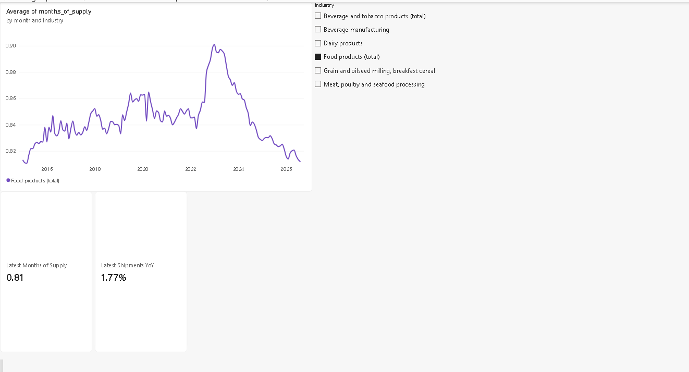
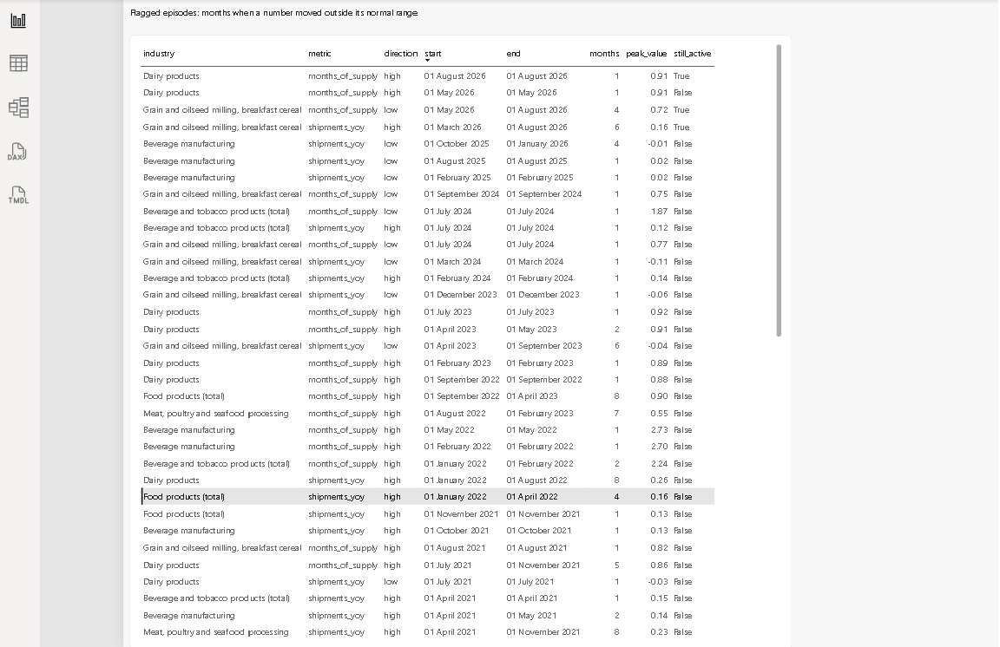

# supply-chain-analytics

Analytics modules built on **real public data**. Nothing here is invented or simulated.

## Module 1: Food and Beverage Demand-Supply Monitor (`pepsico_planning/`)

**Question:** Is demand for US food and beverage manufacturing running ahead of or behind supply, and which months deserve a planner's attention?

**Data:** US Census Bureau, *Manufacturers' Shipments, Inventories and Orders (M3)*, downloaded from the official API
(`https://api.census.gov/data/timeseries/eits/m3`). Monthly, public.

**Limitation:** M3 covers US manufacturers. It is not data from any single company, and it does not cover Asia-Pacific, India, Middle East or South Africa markets.

### Status

| Step | State |
| --- | --- |
| Download script (`fetch_m3.py`) | Done, run on live Census data |
| Code discovery (`explore_m3.py`) | Done, run on live data |
| KPI functions (`kpis.py`) | Done, unit-tested, months of supply checked against the Census ratio |
| Forecast and backtest (`forecast.py`) | Done, run on live data. It does not beat the simple baseline for the food total, grain and cereal, or dairy |
| Map category codes to industries | Done |
| DuckDB load, exceptions, episodes (`build_monitor.py`) | Done |
| Excel workbook and Power BI dashboard | Done (`outputs/monitor.xlsx`, `docs/Dashboards/food_beverage_monitor.pbix`) |
| Status one-pager | Done (`docs/weekly_status.md`) |
| Process map and risks log | Next |

### Run

```
python -m pip install -r requirements.txt
python pepsico_planning/fetch_m3.py
python pepsico_planning/explore_m3.py
python pepsico_planning/build_monitor.py
python -m pytest
```

See `docs/kpi_definitions.md` for how each KPI is calculated.

## Dashboard (Power BI)

The Power BI report `food_beverage_monitor.pbix` reads `outputs/monitor.xlsx`.

**Page 1: Overview.** Months of supply by month and industry, with an industry slicer and two cards for the latest month (August 2026).


**Page 2: Flagged episodes.** Months when months of supply or shipments growth moved outside the trailing 36-month normal range, newest first.


How to read it:
- Months of supply is inventory divided by shipments. The food total stays below one month, so a small move looks large on the chart because the vertical axis is narrow.
- In the episodes table, `peak_value` is months of supply for `months_of_supply` rows and a fraction for `shipments_yoy` rows (0.16 means 16%).
- `still_active = True` means the episode is still running in the latest month.

Limits:
- The data is US Census M3 data for US manufacturers. It is not PepsiCo data.
- Food and beverage have no orders data, so there are no backlog or order-to-ship measures.
- Shipments are in current dollars, so price changes move them.
- The forecast does not beat a simple "same month last year" baseline for the food total, grain and cereal, or dairy. It is shown for transparency, not as a reliable prediction.


